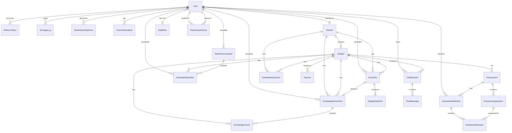
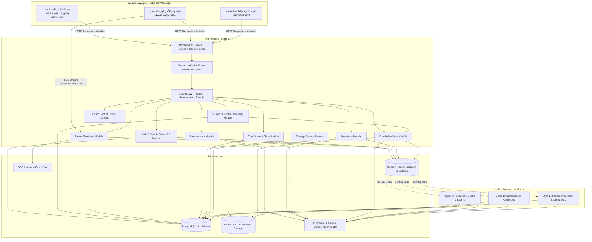
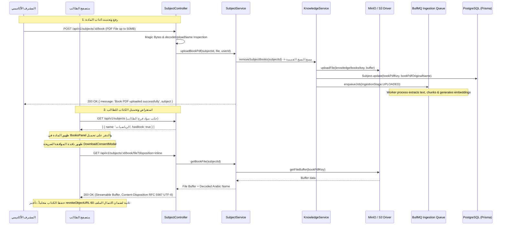

# 📘 التوثيق التقني الشامل لمنظومة مسار التميز (AI Exam) — Monorepo Architecture

---

## 1. نظرة عامة على المشروع (Project Overview)

### الغرض والرؤية
منظومة **«مسار التميز» (AI Exam)** هي منصة تعليمية ذكية متكاملة مصممة خصيصاً لإعداد وتأهيل طلبة الثانوية العامة (التوجيهي الفلسطيني) للامتحانات الوزارية بكفاءة واقتدار، مع توفير بوابة رقابة وإشراف لحظي لأولياء الأمور ولوحة تحكم متقدمة للإدارة الأكاديمية والمكتبة الرقمية للكتب والمراجع الوزارية.

تقدم المنظومة حلاً شاملاً عبر 4 ركائز رئيسية:
- **بوابة الطالب (Student Portal)**:
  - توليد أسئلة تدريبية مخصصة ومحاكاة للامتحانات الوزارية بالذكاء الاصطناعي (RAG).
  - محادثة ذكية وتدريس تفاعلي (AI Tutor Chat) مع تصنيف النوايا وفهم سياق المادة الدراسية.
  - بنك أسئلة وزاري شامل مستخرج ومفهرس من امتحانات السنوات السابقة عبر OCR والبحث الهجين (Hybrid Search).
  - اختبارات تشخيصية لقدرات الطالب وفق مستويات تصنيف بلوم (Bloom's Taxonomy) مع حفظ مسودات مرن ومقاوم لانقطاع التخزين واختصارات لوحة المفاتيح الآمنة.
  - **لوحة الكتب والمراجع الرسمية (`BooksPanel`)**: استعراض الكتب المدرسية المعتمدة لفرع الطالب، والتحميل الآمن بصيغة PDF مع نافذة موافقة صريحة (`DownloadConsentModal`) وحماية ضد التنزيل العشوائي وتجاوز مشاكل مديري التنزيل (IDM/FDM).
  - كويزات تفاعلية فورية ومتابعة خطة الدراسة اليومية وجداول المراجعة.
- **بوابة ولي الأمر (Parent Portal)**:
  - ربط فوري بالأبناء عبر مسح QR Code أو إدخال رمز الربط (PIN).
  - لوحة تحكم ومؤشرات أداء يومية دقيقة (`todayKpis`) تفصل بين الأسئلة المحلولة والمولدة.
  - بث حي وتنبيهات لحظية (Real-time SSE) عند إنهاء الأبناء للاختبارات أو الكويزات.
  - تحليل مكامن القوة ونقاط الضعف مع توصيات إرشادية موجهة من الذكاء الاصطناعي.
  - مؤشر القدرات المعرفية وسجل زمني أكاديمي متكامل مع فلترة مخصصة وتبديل فوري بين الأبناء دون وميض بيانات قديمة.
- **المكتبة المركزية وإدارة المناهج (Curriculum & Digital Library)**:
  - رفع وإدارة كتب المناهج الدراسية الرسمية بصيغة PDF حتى 50MB لكل مادة.
  - خط أنابيب تلقائي يربط رفع الكتاب بفهرسته وتقطيعه (Chunking) وتوليد التضمينات (Embeddings) في قاعدة المعرفة لدعم التوليد الذكي للأسئلة.
  - تخزين سحابي موحد على MinIO / S3 مع فحص البايتات السحرية (Magic Bytes) والاستشفاء الذاتي للملفات.
  - واجهة إدارة مكتبية متقدمة (`/admin/library`) تتيح تتبع حالة المعالجة وإعادة التضمين والتنزيل المباشر والحذف الآمن.
- **لوحة تحكم الإدارة (Platform Admin)**:
  - إدارة الفروع، المواد الدراسية، الكتب الوزارية، وتدقيق استخراج الأسئلة من الـ PDF (Staging).
  - إدارة المستخدمين والصلاحيات الدقيقة (RBAC) وأدوار الفريق.
  - مراقبة استهلاك نماذج الـ AI والتكاليف وحصص الاستخدام اليومية وسياسات الاسترجاع.

### النمط المعماري (Monorepo Architecture)
يعتمد المشروع هيكلية **Monorepo** موحدة بنظام Workspaces تجمع الـ Backend، الـ Frontend، والمكتبات المشتركة:

```
Full Ai-Exam/
├── apps/
│   ├── api/                   ← الـ Backend الرئيسي (NestJS 11 + Prisma + BullMQ)
│   │   ├── src/
│   │   │   ├── main.ts        ← نقطة دخول HTTP Server + Vercel Handler
│   │   │   ├── worker.ts      ← عملية Worker مستقلة (BullMQ jobs)
│   │   │   ├── app.module.ts  ← Root Module يجمع 20 موديولاً
│   │   │   ├── auth/          ← المصادقة المتقدمة: JWT, Google OAuth 2.0, 2FA, Denylist, Parent Auth
│   │   │   ├── parent/        ← بوابة أولياء الأمور: ربط، لوحة متابعة، بث حي SSE
│   │   │   ├── assessments/   ← محرك اختبارات تقييم القدرات التشخيصية (Bloom's Taxonomy)
│   │   │   ├── questions/     ← توليد الأسئلة بالذكاء الاصطناعي (RAG + Style)
│   │   │   ├── exam-bank/     ← بنك الأسئلة والبحث الهجين (Vector + Text)
│   │   │   ├── chat/          ← المساعد الذكي وتصنيف نوايا الطالب
│   │   │   ├── knowledge/     ← قاعدة المعرفة واستخراج وتقطيع وتضمين الكتب
│   │   │   ├── gemini/        ← تكامل الذكاء الاصطناعي (Gemini, Claude, OpenRouter)
│   │   │   ├── platform/      ← لوحة التحكم الإدارية والصلاحيات
│   │   │   ├── usage/         ← تتبع الاستهلاك وحصص التوليد والميزانية
│   │   │   ├── branch/        ← الفروع الأكاديمية (علمي، أدبي، صناعي، شرعي)
│   │   │   ├── subject/       ← المواد والكتب المدرسية وخدمات الرفع والدفق والتنزيل
│   │   │   ├── teachers/      ← المعلمون النموذجيون والمحاكاة
│   │   │   ├── users/         ← الملف الشخصي للطلبة
│   │   │   ├── storage/       ← محرك التخزين السحابي الموحد (MinIO / S3 Driver)
│   │   │   ├── redis/         ← التخزين المؤقت والطوابير وحظر التوكنز
│   │   │   ├── mail/          ← خدمة البريد الإلكتروني
│   │   │   └── common/        ← الحراس، الفلاتر، السياق، فحص الملفات (Magic Bytes)، والترميز
│   │   └── prisma/            ← مخطط قاعدة البيانات والـ Migrations والـ Seed
│   │
│   └── web/                   ← الـ Frontend الكامل (Next.js 16 + React 19 + Tailwind CSS v4)
│       ├── app/
│       │   ├── (main)/        ← صفحات الاستكشاف والمحتوى العام
│       │   ├── home/          ← لوحة الطالب الذكية، بطاقات المواد، ولوحة الكتب والمراجع (BooksPanel)
│       │   ├── assessments/   ← محرك إجراء الاختبارات التشخيصية مع اختصارات لوحة المفاتيح
│       │   ├── quizzes/       ← كويزات الممارسة الفورية (QuizFlow)
│       │   ├── parent/        ← بوابة ولي الأمر (لوحة المتابعة + تسجيل الدخول الآمن بـ PIN)
│       │   ├── exams/         ← استعراض وتصفية بنك الامتحانات الوزارية
│       │   ├── ai-path/       ← المسار التعليمي المخصص
│       │   ├── admin/         ← لوحة تحكم المشرفين (المكتبة الرقمية /admin/library، المستخدمين، الأدوار)
│       │   ├── account/       ← الملف الشخصي ورمز QR لربط ولي الأمر
│       │   ├── oauth/         ← استقبال ومعالجة Google OAuth 2.0 (Success, 2FA, Errors)
│       │   ├── select-branch/ ← شاشة اختيار وتأكيد الفرع الأكاديمي للطلبة الجدد
│       │   ├── daily-plan/    ← متابعة وإنجاز الخطة والمهام اليومية
│       │   └── verify-otp/    ← شاشة إدخال رمز التحقق للبريد وتفعيل الحساب
│       ├── components/        ← مكونات واجهة المستخدم (GoogleLoginButton، التقييم، الكويز، الوالدين)
│       └── lib/               ← دوال الربط الشبكي، مكتبة تنزيل الكتب (books.ts)، والتخزين المحلي المرن
│
└── packages/
    └── types/                 ← العقود البرمجية المشتركة (@ai-exam/types)
        ├── src/
            ├── entities.ts    ← الكيانات المشتركة (Subject مع hasBook، User، Parent، إلخ)
            ├── enums.ts       ← التعدادات الموحدة بين Backend و Frontend
            ├── permissions.ts ← الصلاحيات وأدوار النظام
            ├── assessments.ts ← عقود الاختبارات والتقييم
            ├── questions.ts   ← عقود الأسئلة والتوليد
            └── chat.ts        ← عقود المحادثة والنوايا
```

العملية في الـ Backend مقسومة لعمليتين:
- **API Process** (`main.ts`): يخدم طلبات HTTP وبث الـ SSE ودفق ملفات الكتب وتوليد الروابط الموقعة.
- **Worker Process** (`worker.ts`): يشغّل المهام الثقيلة (OCR, Embeddings, Style Extraction, Knowledge Ingestion) دون خادم HTTP لتفادي تجميد واجهة الـ API.

---

## 2. حزمة التقنيات (Tech Stack)

### 2.1 الـ Backend وخدمات البنية التحتية (`apps/api`)

| التقنية | الإصدار | الغرض | الملفات |
|---|---|---|---|
| **Node.js** | >= 20.9 | Runtime | `package.json` |
| **TypeScript** | ^5.7.3 | Language | `apps/api/tsconfig.json` |
| **NestJS** | ^11.0.1 | Backend Framework | `apps/api/package.json` |
| **PostgreSQL** | 16 (Alpine) | Relational Database | `docker-compose.yml` |
| **Prisma** | ^6.19.3 | Type-Safe ORM | `prisma/schema.prisma` |
| **Redis** | 7 (Alpine) | Cache / Queues / Rate Limiting / Denylist | `docker-compose.yml` |
| **ioredis** | ^6.0.0 | High-Performance Redis Client | `redis/redis.service.ts` |
| **BullMQ** | ^6.2.0 | Background Job Queue | `app.module.ts` |
| **MinIO / AWS S3** | MinIO Latest / S3 API | Unified Cloud Object Storage للكتب والامتحانات | `storage/drivers/s3-storage.driver.ts` |
| **@aws-sdk/client-s3** | ^3.1116.0 | AWS S3 Client | `storage/drivers/s3-storage.driver.ts` |
| **@aws-sdk/s3-request-presigner** | ^3.1116.0 | Presigned URLs Generation | `storage/drivers/s3-storage.driver.ts` |
| **@aws-sdk/lib-storage** | ^3.1116.0 | S3 Multipart / Streaming Uploads | `storage/drivers/s3-storage.driver.ts` |
| **@google/genai** | ^2.18.0 | Google Gemini AI SDK | `gemini/gemini.service.ts` |
| **@anthropic-ai/sdk** | ^0.128.0 | Claude AI SDK | `gemini/claude.client.ts` |
| **@huggingface/transformers** | ^4.3.0 | Local Embeddings (multilingual-e5) | `gemini/local-embedder.ts` |
| **Passport + JWT** | passport ^0.7 / passport-jwt ^4.0 | Authentication Strategy | `auth/strategies/jwt.strategy.ts` |
| **passport-google-oauth20** | ^2.0.0 | استراتيجية Google OAuth 2.0 المصادقة بحسابات Google | `auth/strategies/google.strategy.ts` |
| **@nestjs/jwt** | ^11.0.2 | JWT Signing/Verification | `auth/services/token.service.ts` |
| **bcryptjs** | ^3.0.3 | Password & PIN Hashing | `auth/services/auth.service.ts` |
| **class-validator / class-transformer** | ^0.15 / ^0.5 | DTO Validation & Transformation | كل مجلد `dto/` |
| **Swagger** | ^11.4.6 | Interactive API Documentation | `main.ts` |
| **nodemailer** | ^9.0.3 | SMTP Email Transport | `mail/mail.service.ts` |
| **tesseract.js** | ^5.1.1 | OCR (PDF -> Text) | `gemini/gemini.service.ts` |
| **unpdf** | ^1.8.1 | PDF Text & Structure Extraction | `knowledge/services/document-extractor.service.ts` |
| **pdf-lib** | ^1.17.1 | PDF Manipulation & Validation | `apps/api/package.json` |
| **qrcode** | ^1.5.4 | QR Code Generation for Parent Linking | `apps/api/package.json` |
| **helmet** | ^8.3.0 | HTTP Security Headers & CSP | `main.ts` |
| **cookie-parser** | ^1.4.7 | Cookie Parsing for JWT & OAuth State | `main.ts` |
| **Jest** | ^30.0.0 | Unit & E2E Testing Framework (57 Test Suites) | `apps/api/package.json` |
| **@nestjs/schedule** | ^12.0.2 | Automated Cron Jobs | `auth/tasks/token-cleanup.task.ts` |
| **@nestjs/event-emitter** | ^3.1.0 | Event-Driven Bus (Assessments, Quizzes) | `app.module.ts` |
| **Magic Bytes Inspector** | Custom Utility | فحص البايتات السحرية للتحقق الصارم من سلامة الـ PDF والصور | `common/file-type.util.ts` |
| **Mojibake Resolver** | Custom Utility | فك ترميز الأسماء العربية للملفات (`decodeUploadName`) وتصحيح Windows-1252/latin1 | `common/file-type.util.ts` |

### 2.2 الـ Frontend وتجربة المستخدم (`apps/web`)

| التقنية | الإصدار | الغرض | الملفات |
|---|---|---|---|
| **Next.js** | 16.2.12 | React Framework (App Router, Server Actions, Reverse Proxy Rewrites) | `apps/web/package.json` |
| **React** | 19.2.4 | UI Library | `apps/web/package.json` |
| **Tailwind CSS** | ^4.0.0 | Modern Utility-First Styling System | `apps/web/app/globals.css` |
| **Lucide React** | ^1.28.0 | Iconography System | `apps/web/package.json` |
| **KaTeX** | ^0.16.47 | رندرة المعادلات والرموز الرياضية والعلمية | `apps/web/package.json` |
| **qrcode.react** | ^4.2.0 | توليد كود QR لربط حساب الطالب بولي أمره | `apps/web/package.json` |
| **Books Management UI** | Custom Component | لوحة استعراض وتحميل الكتب المدرسية بصيغة PDF مع نافذة الموافقة الصريحة | `apps/web/app/home/_components/BooksPanel.tsx` |
| **Resilient Book Downloader** | Custom Client Service | مكتبة تنزيل الكتب مع تجاوز IDM وفحص الملفات الفارغة وتأخير إبطال الـ Blob | `apps/web/lib/books.ts` |
| **Admin Library Panel** | Admin Module | لوحة المكتبة الرقمية لإدارة كتب المناهج وملفات الامتحانات ومراقبة التضمين | `apps/web/app/admin/library/page.tsx` |
| **Server-Sent Events (SSE)** | Native Web API | استقبال التنبيهات والأحداث الأكاديمية اللحظية لأولياء الأمور | `apps/web/app/parent/dashboard/page.tsx` |
| **Client Storage Resilience** | Custom Fallback | تخزين مسودات الإجابات مع الانتقال لـ sessionStorage عند امتلاء الذاكرة | `apps/web/lib/assessment.ts` |

### 2.3 الحزم المشتركة (`packages/types`)

| الحزمة | الإصدار | الغرض |
|---|---|---|
| **@ai-exam/types** | 0.0.1 | عقد برمجيات TypeScript موحد ومُشارك بين الـ API والـ Web (Entities, Enums, Permissions, DTOs, `Subject.hasBook`) |

---

## 3. الميزات (Features) — بالتفصيل

### 3.1 إدارة الكتب والمواد الدراسية والمكتبة الرقمية (Subject & Digital Library Module)

تم تطوير هذا الموديول ليكون الركيزة الأساسية للمحتوى التعليمي الوزاري، حيث يربط بين المنهج الدراسي، ملفات الكتب الأصلية، محرك استخراج المعرفة بالذكاء الاصطناعي، وتجربة التحميل المباشرة للطلبة والمشرفين.

**الملفات:**
- `subject/subject.controller.ts` — 11 مساراً API للطلاب والإدارة
- `subject/subject.service.ts` — المنطق المعقد للرفع، الحذف، التنزيل، والاستشفاء الذاتي
- `knowledge/services/knowledge.service.ts` — الربط التلقائي وتفريغ الكتب القديمة
- `common/file-type.util.ts` — فحص البايتات السحرية وحل تشوه الأسماء العربية (Mojibake)
- `apps/web/app/home/_components/BooksPanel.tsx` — واجهة عرض وتحميل الكتب للطلبة مع نافذة الموافقة
- `apps/web/lib/books.ts` — مكتبة التنزيل المرنة وتخطي برامج التنزيل الخارجية (IDM/FDM)
- `apps/web/app/admin/library/page.tsx` — لوحة المكتبة الرقمية الإدارية

**جدول الـ Endpoints الكامل لموديول المواد والكتب:**

| Endpoint | Method | الحماية والصلاحيات | الوظيفة |
|---|---|---|---|
| `/subjects` | `GET` | Authenticated (Student) | جلب مواد الفرع الأكاديمي للطالب الحالي مع حقل `hasBook` |
| `/subjects/all` | `GET` | Public | استعراض كل المواد مع فلترة بالفرع والبحث بالاسم |
| `/subjects/branch/:branchId` | `GET` | Public | جلب مواد فرع محدد مع حالة توفر الكتب (`hasBook`) |
| `/subjects/:id` | `GET` | Public | جلب تفاصيل المادة مع الفرع والمعلمين والإحصائيات |
| `/subjects` | `POST` | `academics.manage` (Admin) | إنشاء مادة دراسية جديدة ضمن فرع أكاديمي |
| `/subjects/:id` | `PATCH` | `academics.manage` (Admin) | تعديل اسم المادة أو فرعها الأكاديمي |
| `/subjects/:id` | `DELETE` | `academics.manage` (Admin) | حذف مادة دراسية وتنظيف كتابها المرتبط من التخزين السحابي |
| `/subjects/:id/book` | `POST` | `academics.manage` أو `content.upload` | رفع أو استبدال كتاب المادة (PDF حتى 50MB) مع جدولة التقطيع والتضمين |
| `/subjects/:id/book/download` | `GET` | Authenticated | تحميل الكتاب أو توليد رابط موقّع S3 (`mode=url`) باسم الملف الأصلي |
| `/subjects/:id/book/file` | `GET` | Authenticated | دفق الكتاب مباشرة كـ Proxy Stream مع `disposition=inline` لحماية الدفق من IDM |
| `/subjects/:id/book` | `DELETE` | `academics.manage` أو `content.upload` | حذف كتاب المادة وتنظيف التخزين السحابي وقاعدة المعرفة |

**الميزات التقنية والمعمارية لإدارة الكتب:**
1. **التكامل التلقائي مع خط أنابيب المعرفة (Knowledge Ingestion Integration)**:
   - عند رفع كتاب PDF عبر `POST /subjects/:id/book`، يستدعي `SubjectService` دالة `KnowledgeService.removeSubjectBooks(subjectId)` لتنظيف أي كتب قديمة أو مقاطع مجزأة (`KnowledgeChunk`) سابقة للمادة.
   - يتم رفع الملف إلى MinIO/S3 تحت المسار الموحد `knowledge/books/{timestamp}-{safeName}` أو `books/{subjectId}/book.pdf`.
   - يتم إدراج مهمة BullMQ تلقائياً لمعالجة الكتاب (استخراج النصوص، التقطيع الهيكلي، وحساب التضمينات الرياضية والنصية)، مما يجعل محتوى الكتاب متاحاً فوراً كمصدر RAG لتوليد الأسئلة والمحادثة الذكية.
2. **الاستشفاء الذاتي لبيانات الكتب (Self-Healing Architecture)**:
   - في حال كان مفتاح الكتاب `bookPdfKey` مفقوداً في جدول `Subject` ولكنه مسجل في جدول `KnowledgeDocument` (kind: BOOK)، يقوم `SubjectService` تلقائياً بالعثور على الملف وتحديث سجل المادة في قاعدة البيانات ببيانات المفتاح والاسم الأصلي وحجم الملف.
3. **حل معضلة تشوه الأسماء العربية (Mojibake & UTF-8 Encoding Resolution)**:
   - تقوم مكتبة `busboy/multer` في Node.js بفك ترويسات `multipart/form-data` بترميز `latin1` أو `Windows-1252` بدلاً من `UTF-8`، مما يتسبب في وصول أسماء مثل «اللغة العربية.pdf» بصيغة مشوهة مثل «Ø§Ù...».
   - عبر دالة `decodeUploadName` في `common/file-type.util.ts`، يتم فحص البايتات وإعادة رسمها بالخريطة العكسية لـ Windows-1252 و latin1 وتحويلها إلى UTF-8 سليم ونقي.
   - عند إعادة إرسال الملف في ترويسة `Content-Disposition`، يُرسل الاسم بنمط RFC 5987 المزدوج: اسم بديل ASCII للحماية، واسم كامل معرّب بترميز `filename*=UTF-8''...` يضمن حفظ الملف على جهاز الطالب باسمه العربي الصحيح.
4. **حماية التنزيل من برامج التحميل الخارجية ومنع الملفات الفارغة (IDM Bypass & Zero-Byte Prevention)**:
   - برامج التنزيل مثل (Internet Download Manager - IDM) تقوم باعتراض طلبات التنزيل إذا كانت الترويسة `attachment` و `application/pdf`، مما يقطع دفق المتصفح (Browser Stream) ويؤدي لحفظ ملف فارغ بحجم 0 بايت لدى الطالب.
   - تم حل ذلك عبر دفق الملف بـ `disposition=inline` ودعم ترويسة `Accept: application/octet-stream`، مما يسمح للمتصفح بقراءة دفق البيانات بالكامل عبر Fetch API.
   - **خط دفاع ثانٍ (Fallback)**: إذا عاد الـ blob بحجم 0 بايت، تسقط الواجهة فوراً لاستدعاء `/subjects/:id/book/download?mode=url` واستخدام رابط موقّع مباشر من S3.
   - **تأخير تفريغ الذاكرة**: تأخير استدعاء `URL.revokeObjectURL(url)` لمدة 60 ثانية لضمان اكتمال كتابة الملف على القرص في متصفحات Chrome و Chromium دون قطع الاتصال مبكراً.
5. **لوحة عرض الكتب وتأكيد الموافقة الصريحة (`BooksPanel` & `DownloadConsentModal`)**:
   - في صفحة الطالب الرئيسية `/home`، تعرض اللوحة مواد فرع الطالب مع تمييز حالة توفر الكتاب ("متاح بصيغة PDF" أو "قيد الإعداد والرفع").
   - عند النقر على "تحميل الكتاب"، لا يبدأ التنزيل بشكل مفاجئ؛ بل تظهر نافذة تأكيد منبثقة توضح اسم الكتاب والفرع وزر تأكيد مخصص مع مؤشر دوران تفاعلي (`Loader2`)، مع إمكانية الإغلاق بمفتاح Escape.

---

### 3.2 محرك التخزين السحابي الموحد (Unified S3/MinIO Storage Engine)

تم توحيد محرك التخزين بالكامل ليعتمد على معيار S3 المتوافق مع MinIO السحابي المحلي وخوادم AWS S3، وإلغاء محرك التخزين المحلي التقليدي تفادياً لتشتت الملفات وضمان سهولة النشر والنسخ الاحتياطي.

**الملفات:**
- `storage/drivers/s3-storage.driver.ts` — محرك التخزين السحابي الرئيسي
- `storage/storage.service.ts` — واجهة Facade الموحدة
- `storage/storage.module.ts` — تهيئة المزود الشامل (`STORAGE_DRIVER`)
- `common/file-type.util.ts` — التحقق الصارم من البايتات السحرية

**القدرات المعمارية للتخزين:**
- **التحقق التلقائي وإنشاء الـ Buckets (`ensureBucketExists`)**: عند إقلاع النظام، يتحقق المشغل من وجود حاوية التخزين على خادم MinIO (`ai-exam-project`) وإنشائها تلقائياً إذا لم تكن موجودة.
- **البحث متعدد الحاويات (Multi-Bucket Resolution)**: يدعم البحث في قائمة حاويات مرشحة (`ai-exam-project`, `ai-exam`, `ai-exam-bank-storage`) لضمان عدم فقدان أي ملف تم رفعه في إصدار سابق.
- **الترحيل التلقائي من التخزين المحلي القديم (Legacy Local File Migration)**: في حال وجود ملف قديم على القرص المحلي تحت مجلد `./uploads` تم طلبه بعد التحديث، يقوم المحرك تلقائياً بقراءته، رفعه إلى MinIO، ومزامنته في الخلفية دون أي انقطاع في الخدمة.
- **توليد الروابط الموقعة (Presigned S3 URLs)**: توليد روابط تنزيل آمنة ومحددة بوقت (تصل لساعة افتراضياً أو 10 دقائق لملفات المعالجة) مع حقن اسم الملف العربي في `ResponseContentDisposition`.
- **فحص البايتات السحرية (Magic Bytes Inspection)**:
  - عدم الاكتفاء بامتداد الملف أو ترويسة `Content-Type` المرسلة من العميل لمنع هجمات التزييف (MIME-Spoofing).
  - فحص البايتات الأربعة الأولى للملف في الذاكرة:
    - **PDF**: يبدأ بـ `%PDF` (`0x25 0x50 0x44 0x46`).
    - **PNG**: يبدأ بـ `\x89PNG` (`0x89 0x50 0x4E 0x47`).
    - **JPEG**: يبدأ بـ `\xFF\xD8\xFF`.
    - **GIF**: يبدأ بـ `GIF8` (`0x47 0x49 0x46 0x38`).
    - **WEBP**: يبدأ بـ `RIFF` وينتهي بـ `WEBP`.

---

### 3.3 المصادقة والأمان (Auth Module & Google OAuth 2.0)

**الملفات:**
- `auth/auth.controller.ts` — 19 Endpoint
- `auth/services/auth.service.ts` — منطق المصادقة الأساسي
- `auth/services/token.service.ts` — إصدار وتدوير JWT
- `auth/services/two-factor.service.ts` — TOTP 2FA
- `auth/services/oauth.service.ts` — خدمة Google OAuth 2.0، التحقق وحل المستخدمين
- `auth/strategies/google.strategy.ts` — استراتيجية Passport لمصادقة Google OAuth 2.0
- `auth/services/parent-auth.service.ts` — مصادقة أولياء الأمور وحماية القوة الغاشمة
- `auth/utils/parent-crypto.util.ts` — تشفير الـ PIN ورموز الثقة بالأجهزة
- `auth/services/token-revocation.service.ts` — قائمة حظر Redis (Denylist) بحساب TTL دقيق

**الميزات الأساسية:**
- **دخول هجين آمن**: دعم كلمة المرور، الرموز المؤقتة بالبريد (Passwordless OTP)، المصادقة الثنائية (TOTP 2FA)، تسجيل الدخول السريع عبر Google، ودخول أولياء الأمور برقم الهاتف ورمز الـ PIN المكون من 6 أرقام.
- **الحماية من هجمات التوقيت (Timing Attacks Mitigation)**: استخدام `dummyComparison` وهمي عبر `bcrypt.compare` عند عدم وجود الحساب لتوحيد زمن الاستجابة، والمقارنة الآمنة للرموز عبر `timingSafeEqual`.
- **حماية تسجيل الدخول بـ Google (Google OAuth 2.0 Architecture)**:
  - **CSRF State Cookie Binding**: توليد رمز `state` عشوائي مشفر وربطه بكوكي `oauth_state` (`httpOnly`, `SameSite=Lax`, `Secure`). عند الاستقبال يُفحص التطابق وتُمسح الكوكي فوراً.
  - **Pre-Hijacking Mitigation**: تصفير كلمة المرور `passwordHash: null` تلقائياً إذا كان الحساب المحلي مسجلاً ببريد غير مؤكد مسبقاً وسجل المالك الحقيقي عبر Google.
  - **Open Redirect Prevention**: فحص مسار `next` واشتراط بدئه بـ `/` وحظر البروتوكولات المزدوجة (`//` أو `/\\`).
  - **إنفاذ فحص الإيقاف والـ 2FA**: منع المستخدمين الموقوفين وتوجيه الحسابات ذات المصادقة الثنائية لخطوة التحقق عبر توكن مؤقت صالح لـ 5 دقائق.
  - **حل تعارض الـ Hydration في Next.js**: اعتماد مسار نسبي موحد `GOOGLE_OAUTH_PATH = "/api/v1/auth/oauth/google"` ليعمل بتطابق تام بين SSR و Client عبر Next.js Rewrites.
- **حماية حسابات أولياء الأمور (Parent Security & PII Protection)**:
  - قفل الحساب لمدة 15 دقيقة بعد 5 محاولات PIN خاطئة في Redis.
  - حجب أرقام الهواتف الشخصية تلقائياً في السجلات (`***4567`).
  - توكن ثقة بالأجهزة موقّع بـ HMAC-SHA256 صالح لـ 30 يوماً.
- **منع تضخم ذاكرة Redis (Memory Bloat Prevention)**: عند إلغاء التوكنات، يُحسب عمر الـ TTL في قائمة الحظر بدقة ليعادل المدة المتبقية من عمر التوكن فقط (`exp - now`).

---

### 3.4 توليد الأسئلة بالذكاء الاصطناعي (Questions Module)

**الملفات:**
- `questions/controllers/questions.controller.ts`
- `questions/services/question-generation.service.ts` — RAG Generation
- `questions/services/style-upload.service.ts` — رفع ومحاكاة نمط أوراق الامتحانات
- `questions/services/style-generation.service.ts` — توليد بأسلوب المعلم
- `questions/builders/generation-prompt.builder.ts` — هندسة الأوامر (Prompt Engineering)
- `questions/guards/generation-rate-limit.guard.ts` — حصص التوليد اليومية
- `questions/interceptors/quota-refund.interceptor.ts` — استرجاع الحصة عند فشل الذكاء الاصطناعي

**أنماط التوليد والتشغيل:**
1. **Bank RAG Generation (`POST /questions/generate`)**: استرجاع الأسئلة المرجعية المشابهة من بنك الأسئلة بالبحث الهجين، وصياغة Prompt ذكي لـ Gemini/Claude لتوليد أسئلة مطابقة لمنهاج التوجيهي الفلسطيني.
2. **Style-Source Upload & Matched Generation**: يرفع الطالب صورة أو PDF لامتحان معلمه، ويعمل BullMQ Worker على استخراج مصفوفة الأسلوب (Style Matrix) لتوليد أسئلة تحاكي نفس الصياغة ونمط الخيارات.
3. **الفصل الإحصائي الصارم بين التوليد والحل**: الأسئلة المولدة تُسجل في جدول `GeneratedQuestion` ولا تُحتسب كإنجاز حل (`questionsSolved`) إلا إذا أجاب عليها الطالب فعلياً داخل كويز أو اختبار مكتمل.

---

### 3.5 بنك الأسئلة الوزاري والبحث الهجين (Exam Bank Module)

**الملفات:**
- `exam-bank/controllers/exam-bank.controller.ts` — إدارة وبحث
- `exam-bank/controllers/staging.controller.ts` — تدقيق الأسئلة المستخرجة بالـ AI
- `exam-bank/services/hybrid-search.service.ts` — محرك البحث الهجين
- `exam-bank/processors/embedding.processor.ts` — معالجة التضمينات في الخلفية

**خط الأنابيب (Pipeline):**
1. رفع ملف امتحان وزاري PDF -> حفظ في MinIO وتوليد سجل `ExamFile`.
2. استخراج الأسئلة بالذكاء الاصطناعي و OCR -> تحويلها لأسئلة معلقة `StagedQuestion` (PENDING).
3. مراجعة المشرف الأكاديمي والاعتماد -> تتحول لسؤال معتمد في البنك `ExamBankQuestion` (APPROVED).
4. معالجة التضمين المتجهي في الخلفية عبر BullMQ Worker -> ترقية الحالة لـ `INDEXED`.
5. **البحث الهجين (Hybrid Search)**: دمج البحث الدلالي المتجهي (Cosine Similarity) مع البحث النصي الكامل لـ PostgreSQL (`to_tsvector`) مع تجاهل التشكيل العربي لتقديم أدق نتائج مطابقة.

---

### 3.6 قاعدة المعرفة والمناهج (Knowledge Base Module)

**الملفات:**
- `knowledge/knowledge.controller.ts`
- `knowledge/services/knowledge.service.ts` — إدارة المستندات وتلخيص المكتبة
- `knowledge/services/ingestion-pipeline.service.ts` — مراحل المعالجة
- `knowledge/services/document-extractor.service.ts` — استخراج النصوص بالـ OCR و unpdf
- `knowledge/processors/ingestion.processor.ts` — مشغل مهام الطابور

**مراحل معالجة الكتب والامتحانات (Ingestion Stages):**
```
UPLOADED -> EXTRACTING -> CHUNKING -> CHUNKED -> EMBEDDING -> INDEXED
                                                     | (عند الفشل)
                                                   FAILED
```
- دعم نوعين من المصادر: **BOOK** (كتب المناهج الرسمية وتقطيعها إلى فصول ووحدات تعليمية)، و **EXAM** (أوراق الامتحانات الوزارية واستخراج الأسئلة منها).
- لوحة متابعة فورية للإدارة تعرض حالة المعالجة ومعدل تقدم الصفحات وعدد الأجزاء المقطعة وزر إعادة التضمين المباشر.

---

### 3.7 اختبار تقييم القدرات التشخيصية (Assessments Module)

**الملفات:**
- `assessments/assessments.controller.ts`
- `assessments/assessments.service.ts`
- `apps/web/app/assessments/` — واجهة مشغل الاختبارات
- `apps/web/lib/assessment.ts` — التخزين المحلي المرن

**الميزات الأساسية:**
- **تغطية شاملة لمستويات تصنيف بلوم (Bloom's Taxonomy)**: توليد 10 أسئلة تشخيصية موزعة علمياً على المستويات الستة (التذكر، الفهم، التطبيق، التحليل، التقييم، الابتكار).
- **تجربة مشغل الاختبارات (Runner UX)**:
  - اختصارات لوحة المفاتيح لاختيار البدائل (A, B, C, D) مع الحماية ضد مفاتيح التعديل (`ctrlKey || metaKey || altKey`) لمنع تغيير الإجابة عند محاولة نسخ نص السؤال.
  - **مقاومة أخطاء الذاكرة (Storage Resilience)**: حفظ مسودات الإجابات تلقائياً بعد كل اختيار، مع التحويل التلقائي لـ `sessionStorage` كـ Fallback عند امتلاء ذاكرة `localStorage`.
  - **التعامل الدقيق مع نتيجة الصفر (Zero Score Handling)**: عرض نسبة 0% كعلامة حقيقية بدلاً من اعتبار الطالب "قيد التقييم" عند اكتمال الاختبار.

---

### 3.8 بوابة ونظام أولياء الأمور (Parent Module)

**الملفات:**
- `parent/parent.controller.ts` — 10 مسارات مخصصة لولي الأمر
- `parent/services/parent-linking.service.ts` — الربط ومؤشرات الأداء `todayKpis`
- `parent/listeners/parent-events.listener.ts` — الاستماع لأحداث إكمال الاختبارات
- `apps/web/app/parent/dashboard/page.tsx` — لوحة المتابعة والبث اللحظي

**الميزات ومؤشرات الأداء (`todayKpis`):**
1. **الربط الفوري**: ربط حساب الابن بمسح رمز QR أو إدخال رمز ربط مكون من 6 أرقام يطلبه الوالد من حساب الطالب.
2. **البث الحي اللحظي (Server-Sent Events - SSE)**: تدفق فوري عبر `/parent/events/live` يرسل إشعارات عائمة (Live Toasts) للوالد فور إنهاء ابنه لأي اختبار أو كويز بنتيجته الدقيقة.
3. **دقة المؤشرات اليومية**:
   - احتساب النشاط الأكاديمي الحقيقي فقط واستبعاد الأحداث الإدارية مثل `PARENT_LINKED`.
   - فصل تام بين الأسئلة المحلولة والمولدة.
   - حساب دقيق لمعدل الدقة والالتزام بخطة اليوم.
4. **منع وميض البيانات القديمة (Anti-Stale Flash)**: عند التبديل بين الأبناء في اللوحة، يتم تصفير البيانات فوراً وعرض الهيكل التحميلي (Skeleton) حتى اكتمال جلب بيانات الابن الجديد.

---

### 3.9 المحادثة الذكية والتدريس التفاعلي (Chat Module)

**الملفات:**
- `chat/chat.controller.ts`
- `chat/services/chat.service.ts`
- `chat/services/intent-classifier.service.ts` — تصنيف النوايا بالذكاء الاصطناعي
- `chat/services/content-guardrail.service.ts` — حارس المحتوى الأكاديمي

**الوظائف:**
- محادثة موجهة حسب المادة الدراسية المختارة.
- تصنيف النوايا: استفسار دراسي، طلب توليد أسئلة، متابعة وتعديل صعوبة، أو رفض مهذب للمواضيع الخارجة عن المنهاج (`OFF_TOPIC`).
- حارس محتوى صارم يتحقق من ملائمة الملفات المرفوعة لموضوع المادة الدراسية.

---

### 3.10 الفروع والمعلمون والملف الشخصي (Branch, Teachers, Users)

- **الفروع (`branch`)**: إدارة الفروع الأكاديمية الأربعة (علمي، أدبي، صناعي، شرعي)، اختيار الفرع وتغييره.
- **المعلمون (`teachers`)**: بطاقات المعلمين النموذجيين لكل مادة، رفع صور المعلمين (JPG/PNG/WebP حتى 5MB)، وإعادة ترتيب الظهور.
- **الملف الشخصي (`users`)**: عرض وتعديل بيانات الطالب وربطه بفرعه الأكاديمي وتوليد رمز QR للربط العائلي.

---

### 3.11 مزودات الذكاء الاصطناعي والاستهلاك (AI Providers & Usage)

- **أولوية المزودين (Fallback Chain)**:
  1. Google Gemini (الأساسي عبر `@google/genai`).
  2. Anthropic Claude (إضافي عند توفر المفتاح).
  3. OpenRouter (احتياطي تلقائي عند تعثر المزودين الأساسيين).
- **التضمين المحلي**: دعم تشغيل نموذج `multilingual-e5-small` محلياً عبر `@huggingface/transformers` دون الحاجة لأي اتصال خارجي.
- **تتبع الاستهلاك والتكاليف**: تسجيل كل استدعاء للـ AI مع الـ Latency وحساب التكلفة بالدولار، وإدارة الحصص اليومية للمستخدمين وأدوار الفريق.

---

## 4. تصميم قاعدة البيانات (Database Design)

### مخطط العلاقات (ER Diagram)



### الفهارس الرئيسية (Key Performance Indexes)

| الجدول | الفهرس | الغرض |
|---|---|---|
| `Subject` | `@@index([branchId])`, `@@index([bookPdfKey])` | استرجاع مواد الفرع والتحقق الفوري من توفر الكتب السحابية |
| `User` | `@@unique([oauthProvider, oauthProviderId])`, `@@index([branchId])`, `@@index([role])`, `@@index([lastActiveAt])` | مطابقة حسابات Google بسرعة وموثوقية، فلترة المستخدمين وحساب النشاط الأخير |
| `ParentStudentLink` | `@@unique([studentId, parentId])`, `@@index([studentId])`, `@@index([parentId])`, `@@index([parentPhone])` | استعلامات ربط وتفويض أولياء الأمور ومنع التكرار |
| `StudentActivityEvent` | `@@index([studentId, createdAt])`, `@@index([eventType])` | استعلامات السجل الزمني وأحداث اليوم واستبعاد الأحداث الإدارية |
| `KnowledgeDocument` | `@@unique([s3Key])`, `@@index([subjectId, kind])`, `@@index([stage])` | مراقبة ومعالجة كتب المناهج والامتحانات في قاعدة المعرفة |
| `KnowledgeChunk` | `@@index([subjectId, embeddingStatus])`, `@@index([subjectId, unit])` | تسريع استرجاع مقاطع المعرفة أثناء توليد الـ RAG |
| `ExamBankQuestion` | `@@index([deletedAt, subjectId, difficulty])` | استعلامات البحث الهجين في بنك الأسئلة |
| `RefreshToken` | `@@index([userId, revokedAt])`, `@@index([expiresAt])` | Token Rotation ومسح التوكنز المنتهية |

---

## 5. الاهتمامات العابرة (Cross-Cutting Concerns)

### 5.1 طبقات الحماية والتفويض (Guards Hierarchy)
1. **JwtAuthGuard**: يتحقق من صحة JWT من الكوكيز المشفرة أو ترويسة Bearer، ويتخطى المسارات المعلّمة بـ `@Public()`.
2. **RolesGuard**: يفرض التحقق من أدوار المستخدمين (`STUDENT` / `ADMIN`).
3. **PermissionsGuard**: تفويض دقيق للصلاحيات (`@RequirePermissions` / `@RequireAnyPermission`) مثل `academics.manage`, `content.upload`, `users.manage`.
4. **ThrottleGuard**: تقييد معدل الطلبات عبر Redis لحماية بوابات المصادقة و Google OAuth ورفع وتنزيل الكتب.

### 5.2 التحقق من البيانات والملفات (Validation & File Integrity)
- **Global ValidationPipe**: تفريغ الحقول غير المسموحة (`whitelist: true`)، رفض المدخلات الإضافية (`forbidNonWhitelisted: true`)، وتحويل الأنواع تلقائياً.
- **Magic Bytes Validation**: التحقق من التوقيع الثنائي الحقيقي للملف في الذاكرة لمنع هجمات التزييف وتجاوز الامتدادات.
- **Mojibake Decoding**: إصلاح تشوه أسماء الملفات العربية الناتجة عن اختلاف ترميز المتصفحات مع Multer/Busboy.

### 5.3 معالجة الاستثناءات الموحدة (Exception Handling)
- **AllExceptionsFilter**: معالجة مركزية تترجم أخطاء Prisma (P2000-P2034) إلى رموز HTTP مناسبة (404, 409, 400)، وتنتج رداً موحداً: `{ statusCode, message, timestamp, path }`.

### 5.4 إدارة الجلسات والكاش والذاكرة
- **TTL-Based Denylist**: تخزين التوكنات الملغاة في Redis بمدة بقاء تعادل المدة المتبقية من عمر التوكن فقط (`exp - now`) لمنع تضخم الذاكرة.
- **Single-Origin Proxy via Next.js Rewrites**: توجيه كل طلبات `/api/v1/*` عبر نطاق الواجهة لضمان استقرار كوكيز الجلسة (`httpOnly`) وتفادي مشاكل الـ Cross-Domain.

---

## 6. DevOps والبيئة والتشغيل

### 6.1 خدمات Docker Compose

```yaml
services:
  postgres:
    image: postgres:16-alpine
    ports: ["5432:5432"]
    environment:
      POSTGRES_DB: ai_exam
      POSTGRES_USER: postgres
      POSTGRES_PASSWORD: password

  redis:
    image: redis:7-alpine
    ports: ["6379:6379"]

  minio:
    image: minio/minio:latest
    ports: ["9000:9000", "9001:9001"]
    command: server /data --console-address ":9001"
    environment:
      MINIO_ROOT_USER: minioadmin
      MINIO_ROOT_PASSWORD: minioadminpassword
```

### 6.2 متغيرات البيئة الأساسية (`apps/api/.env`)

| المتغير | الوظيفة |
|---|---|
| `DATABASE_URL` | رابط الاتصال بقاعدة بيانات PostgreSQL |
| `REDIS_URL` | رابط خادم Redis للطوابير والكاش وحظر التوكنز |
| `JWT_SECRET` | المفتاح السري لتوقيع رموز JWT |
| `ENCRYPTION_KEY` | مفتاح تشفير أسرار المصادقة الثنائية (32 بايت) |
| `AWS_S3_ENDPOINT` / `MINIO_ENDPOINT` | عنوان خادم MinIO (افتراضياً: `http://localhost:9000`) |
| `AWS_S3_BUCKET_NAME` | اسم الحاوية السحابية (افتراضياً: `ai-exam-project`) |
| `AWS_ACCESS_KEY_ID` / `MINIO_ROOT_USER` | مفتاح وصول التخزين السحابي |
| `AWS_SECRET_ACCESS_KEY` / `MINIO_ROOT_PASSWORD` | الرمز السري للتخزين السحابي |
| `GEMINI_API_KEY` | مفتاح Google Gemini الأساسي لتوليد الأسئلة والتضمين |
| `GOOGLE_CLIENT_ID` / `GOOGLE_CLIENT_SECRET` | بيانات اعتماد Google OAuth 2.0 |
| `GOOGLE_REDIRECT_URI` | رابط العودة المصرح به (افتراضياً عبر Proxy الواجهة) |
| `FRONTEND_URL` | رابط الواجهة الأمامية (افتراضياً: `http://localhost:3000`) |

### 6.3 تشغيل المشروع محلياً

```bash
# 1. تشغيل الخدمات الأساسية (Postgres, Redis, MinIO)
docker compose up -d

# 2. تثبيت الحزم وبناء الأنواع المشتركة
npm install

# 3. إعداد قاعدة البيانات وتطبيق الـ Migrations وتغذية البيانات الأولية
npm run db:setup

# 4. تشغيل النظام بالكامل (API + Worker + Web App) بالتوازي
npm run dev
```

---

## 7. الاختبارات وضمان الجودة (Testing)

يحتوي المشروع على **57 جناح اختبار** (تضم أكثر من **570 اختباراً آلياً**) تشمل اختبارات الوحدات واختبارات التكامل و E2E وتعمل بنجاح تام 100%:

| مجال الاختبار | الأجنحة | ما يُغطيه |
|---|---|---|
| **المصادقة والأمان (`auth`)** | 8 أجنحة | تسجيل الدخول، تدوير JWT، Google OAuth 2.0، التحقق من State، حماية Pre-hijacking، 2FA، مصادقة أولياء الأمور وقفل الحساب، وتشفير الـ PIN |
| **المواد والكتب (`subject`)** | جناحين | عمليات CRUD، رفع كتب PDF، الدفق المباشر كـ Proxy Stream، توليد الروابط الموقعة، والاستشفاء الذاتي |
| **محرك التخزين (`storage`)** | جناحين | محرك `S3StorageDriver`، إنشاء الحاويات التلقائي على MinIO، البحث متعدد الحاويات، وترحيل الملفات المحلية القديمة |
| **الأدوات المشتركة والحراس (`common`)** | 6 أجنحة | فحص البايتات السحرية (Magic Bytes)، فك تشوه الأسماء العربية (`decodeUploadName`)، تقييد المعدل، والتحقق من الصلاحيات |
| **الاختبارات التشخيصية (`assessments`)** | جناحين | توليد اختبارات تصنيف بلوم، تسليم الإجابات، حساب الدرجات، والتعامل مع نتيجة الصفر |
| **بوابة أولياء الأمور (`parent`)** | 4 أجنحة | ربط الأبناء بـ PIN و QR، حساب مؤشرات `todayKpis`، فصل الأسئلة المحلولة عن المولدة، والبث الحي SSE |
| **بنك الأسئلة والبحث الهجين (`exam-bank`)** | 8 أجنحة | تدقيق الأسئلة (Staging)، البحث الهجين (Vector + Text)، وتضمين الأسئلة في الخلفية |
| **قاعدة المعرفة (`knowledge`)** | 6 أجنحة | خط معالجة الكتب والامتحانات، التقطيع، وتفريغ كتب المواد القديمة |
| **الذكاء الاصطناعي والتوليد (`questions`, `gemini`)** | 8 أجنحة | التوليد RAG، محاكاة أسلوب المعلم، سلاسل المزودين البديلة (Gemini/Claude/OpenRouter)، واسترجاع الحصص |
| **الاختبارات الشاملة (E2E Tests)** | جناحين | دورة المصادقة الكاملة وصحة تشغيل خادم التطبيق |

---

## 8. الرسومات التوضيحية (Architectural Diagrams)

### 8.1 الهيكل العام للمنظومة



### 8.2 مسار رفع وإدارة وتحميل الكتب المدرسية (Book Upload & Download Lifecycle)



---

## 9. المراجعة الفنية والتقييم النهائي (System Review)

### نقاط القوة المعمارية والتقنية
1. **توحيد التخزين السحابي على MinIO / S3**: التخلص التام من تخزين الملفات على القرص المحلي العادي، مما يتيح التوسع الأفقي (Horizontally Scalable) وتفادي ضياع الكتب والامتحانات بين السيرفرات المتعددة.
2. **حل جذري لمشاكل التنزيل والملفات الفارغة (0-Byte Downloads Mitigation)**: استخدام ترويسات `inline` و `application/octet-stream` لتجاوز اعتراض برامج التنزيل الخارجية (IDM/FDM)، وتأخير تفريغ كائنات الـ Blob URL بـ 60 ثانية لضمان اكتمال التحميل.
3. **الحصول على الموافقة الصريحة للطالب (`Consent-First UX`)**: توفير نافذة تأكيد منبثقة قبل بدء التنزيل تحمي باقة الإنترنت وتمنع التحميل العشوائي للكتب الكبيرة.
4. **التحقق الصارم من سلامة الملفات (Magic Bytes Verification)**: فحص التوقيع الثنائي الحقيقي لملفات PDF والصور لحماية الخوادم من هجمات تزييف الامتدادات.
5. **معالجة متقدمة لأسماء الملفات العربية (Mojibake Resolution)**: تصحيح تشوهات الترميز الناتجة عن تعامل Node.js مع ترويسات الـ Multipart، وحقن الترويسات وفق مواصفة RFC 5987.
6. **الاستشفاء الذاتي للملفات (Self-Healing Data Synchronization)**: قدرة موديول المواد على تعويض أي نقص في مفاتيح الكتب عبر البحث التلقائي في قاعدة المعرفة ومزامنة قاعدة البيانات.
7. **منظومة أمان صارمة ومتعددة الطبقات**: دعم Google OAuth 2.0 مع ربط الكوكيز لمنع CSRF، تصفير كلمات المرور لمنع الاستيلاء المسبق، مصادقة أولياء الأمور برمز PIN مع حظر القوة الغاشمة، وحجب أرقام الهواتف الشخصية.
8. **فصل العمليات الثقيلة (Process Separation)**: تشغيل الذكاء الاصطناعي ومعالجة الـ OCR وتقطيع الكتب عبر عملية Worker مستقلة بنظام BullMQ دون التأثير على استجابة خادم الـ HTTP.
9. **تغطية اختبارية شاملة**: 57 جناح اختبار تغطي كافة الموديولات وحالات الحافة والأخطاء المتوقعة.

### التوصيات المستقبلية لمزيد من التطوير
1. **تفعيل الامتداد pgvector في PostgreSQL**: إضافة حقل `vector` مخصص مع فهرس HNSW لتسريع البحث المتجهي في قاعدة المعرفة وقاعدة الأسئلة مع ازدياد حجم البيانات.
2. **إضافة خط أنابيب تكامل مستمر (CI/CD Pipeline)**: إعداد GitHub Actions لتشغيل الفحوصات الآلية (Lint, Types Parity, Jest Tests, Build) تلقائياً عند كل Pull Request.
3. **توزيع الأحمال على خوادم التخزين (CDN Caching)**: ربط التخزين السحابي MinIO/S3 بشبكة توزيع محتوى (مثل Cloudflare CDN) لتسريع تحميل كتب المناهج للطلبة في مختلف المناطق الجغرافية.

---

> **ملاحظة توثيقية**: هذا التوثيق محدث بالكامل ليعكس الحالة الفعلية للشيفرة البرمجية للمشروع بكافة مكونات الـ Backend والـ Frontend والتخزين وقاعدة البيانات، مع تغطية كاملة لميزات إدارة ورفع وتنزيل الكتب المدرسية واللوحات التفاعلية الجديدة.
